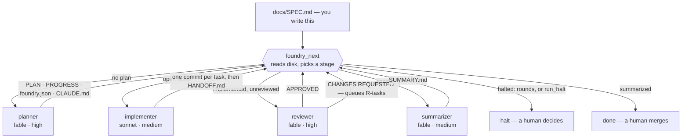
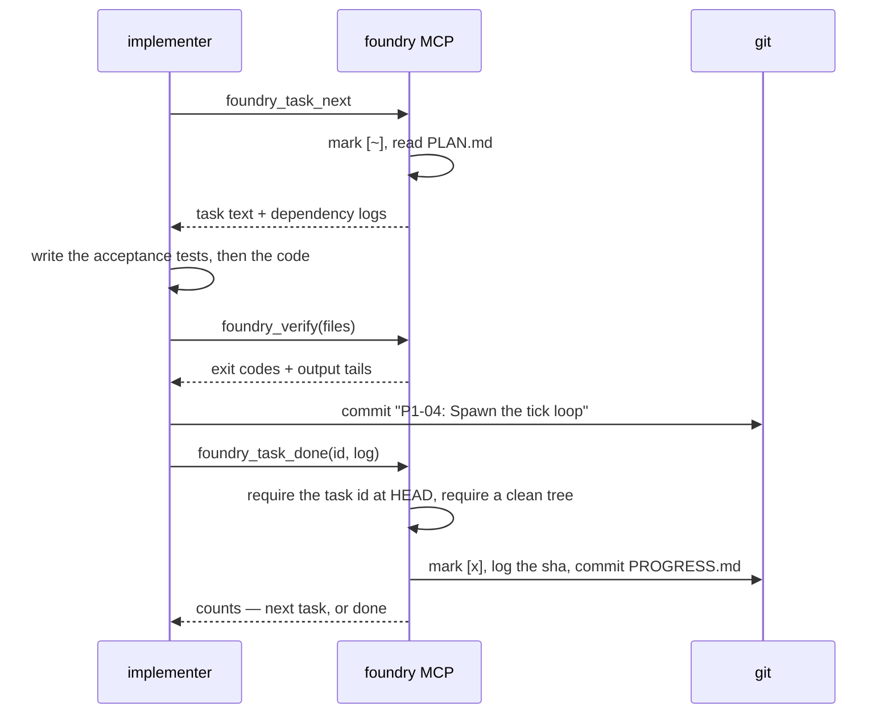
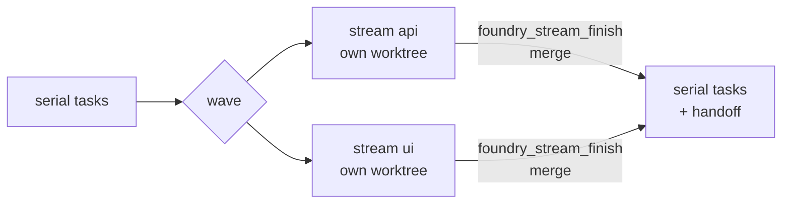

# Foundry

A Claude Code plugin that turns `docs/SPEC.md` into a merge-ready branch with
nobody sitting between the stages. Plan, implement, review, fix, review again,
summarize — a strong model does the judgment work, a cheap one does the
mechanical work, and a zero-dependency MCP server does everything that should
never be left to a language model at all. You write the spec and you merge the
branch. Foundry does the part in between.

## Quickstart

You need Node ≥ 22, git, and Claude Code. Nothing to `npm install`.

1. **Install the plugin.** The repo is its own marketplace.

   ```bash
   claude plugin marketplace add ericmann/foundry
   claude plugin install foundry@ericmann
   ```

2. **Write a spec** in the project you want built, and commit it.

   ```bash
   cd myproject                      # a git repo on its base branch
   mkdir -p docs
   curl -fsSL https://raw.githubusercontent.com/ericmann/foundry/main/templates/SPEC.md -o docs/SPEC.md
   $EDITOR docs/SPEC.md              # docs/writing-specs.md says what the planner needs
   git add -A && git commit -m "spec"
   ```

3. **Fly.** The first run in a project sets up the stage agents and, if
   needed, the MCP allow rule an unattended run cannot answer a permission
   prompt for (see [Per-project use](#per-project-use)). On the default,
   Anthropic-only routing this goes straight through to a reviewed
   `build/<date>` branch; only a role routed off-platform before that first
   sync stops with `FOUNDRY: RESTART REQUIRED` — run it again in a new
   session and it continues.

   ```bash
   claude
   > /foundry:go-flight
   ```

   `/foundry:go-flight` is the documented entry point, but the controller is
   model-invocable too — asking Claude to "run the foundry flight" reaches
   the same instructions. It takes one option, the review depth:
   `/foundry:go-flight max review rounds 6`.

4. **Read `docs/SUMMARY.md`, then merge the branch yourself.** Foundry never
   merges.

> **Optional — run a stage on a different model or backend.** By default the
> planner and reviewer use `fable` and the implementer uses `sonnet`, all on
> your Anthropic account. To point any role somewhere else — `haiku`, a full
> model id, or a local or hosted model through
> [claude-code-router](https://github.com/musistudio/claude-code-router) —
> copy [`templates/foundry.config.example.json`](./templates/foundry.config.example.json)
> to `~/.config/foundry/config.json`, edit the roles or pick a profile with
> `"profile": "local"`, and run `/foundry:go-flight` again — it will ask for
> one more restart only the first time a role not reachable by name (a
> router or local model) is generated. [docs/routing.md](./docs/routing.md)
> has the whole story, including the router setup.

## What's in the box

- **Four stage agents**, each pinned to its own model and effort level by
  default: `planner` (fable, high), `implementer` (sonnet, medium), `reviewer`
  (fable, high), `summarizer` (fable, medium). Switching happens per stage,
  not per session, so the expensive model is only spent on the parts that
  need it.
- **Per-role model routing** — a global config file, optional profiles, and
  a project override — lets you point any role at a cheaper model, local or
  hosted through a router, without changing how the pipeline runs. See
  [docs/routing.md](./docs/routing.md).
- **A flight controller** — `/foundry:go-flight` — that makes no engineering
  decisions. It asks the MCP what runs next, spawns that agent, and repeats
  until the pipeline reports `done` or `halt`.
- **A deterministic MCP server** (`mcp/server.mjs`, no dependencies, Node ≥ 22)
  that owns stage selection, task selection, dependency skipping, checkbox
  edits, log entries, verification runs and every bookkeeping commit. The
  prose in the skills directs judgment; it never describes mechanics.
- **A Stop-hook guard** that refuses to let the implementer stop while tasks
  are open, and gives up after a configurable cap so a wedged run ends instead
  of spinning forever.
- **Blocked-task handling** that keeps an unattended run moving: a task that
  cannot be done is reset, logged and left for the reviewer; its dependents are
  skipped rather than attempted.
- **A complete paper trail on disk** — plan, progress, handoff, review,
  summary — all committed, so a flight can be resumed from any point by
  re-running one command.

## How a flight works



Nothing in that loop is decided by a model reading its own past output. Every
arrow is `foundry_next` re-reading what is actually on disk, which is why a
flight survives compaction, a crashed subagent, or being resumed a day later.
The models shown above are the plugin's own defaults; per-machine and
per-project routing can point any stage somewhere else — see
[docs/routing.md](./docs/routing.md).

## The task loop

Inside the implement stage, the MCP holds the pen on everything except the code
itself:



The implementer never edits `docs/PROGRESS.md`, never chooses its own next
task, and cannot mark work done that it did not commit.

## Parallel workstreams

A plan may split independent tasks into **streams**. Tag a task with
`**Stream:** <slug>` in `PLAN.md` and `{stream: <slug>}` on its `PROGRESS.md`
line; a run of consecutive streamed tasks is a **wave**, and any untagged task
is a barrier between waves. The flight controller then runs a wave's streams
at the same time, each on its own implementer in its own git worktree
(`.foundry/worktrees/<stream>`, on a branch `<build-branch>--<stream>`), and
merges each stream back into the build branch the moment it finishes.



Foundry checks the partition and never trusts it: each streamed task must list
concrete backticked `Files touched`, disjoint across a wave's streams, with
no dependency between streams of a wave. A wave that fails the check, or
whose `parallel.setup` fails, simply runs serially and logs one feedback entry
— a bad partition is a planning defect, never a halt. A command marked
`exclusive` (wp-env, anything bound to a port or a directory) only ever runs
from the main checkout, and the tasks that trigger it stay out of waves.
`docs/foundry.json`'s `parallel.maxStreams` (default 3; `1` turns it off) and
`parallel.setup` (the install a fresh worktree needs) configure it. A plan with
no streams behaves exactly as it always did. See
[docs/architecture.md](./docs/architecture.md#parallel-workstreams) for how,
and [docs/operations.md](./docs/operations.md#parallel-streams) for what to
set and how to recover.

## Install

The [Quickstart](#quickstart) installs from the marketplace. To try a
checkout for one session instead:

```bash
claude --plugin-dir /path/to/foundry
```

Plugin skills are namespaced, so the entry point is `/foundry:go-flight`; the
bare `/go-flight` form does not resolve for plugin skills.

## Per-project use

```bash
mkdir myproject && cd myproject && git init -b main
mkdir docs
cp /path/to/foundry/templates/SPEC.md docs/SPEC.md   # then write the spec
# drop mockups, fixtures and diagrams next to it in docs/
git add -A && git commit -m "spec"

claude
> /foundry:go-flight
```

An unattended implementer that hits a permission prompt sits there until the
guard's cap trips, so two kinds of prompt have to be dealt with up front, and
they are handled differently:

- **File edits.** The generated `foundry-<role>` agents carry
  `permissionMode: acceptEdits`, which plugin-shipped agents cannot. Once
  they exist, the implementer's edits never prompt and `--permission-mode
  acceptEdits` on launch is no longer needed.
- **MCP tool calls.** A subagent's permission mode does not cover these: a
  generated agent's `foundry_status` call is denied under both `acceptEdits`
  and `bypassPermissions` unless the session carries an allow rule.
  `foundry_agents_sync` writes this rule for you (F-03), into the project's
  `.claude/settings.local.json`, unless it is already covered there or in
  the committed `.claude/settings.json` — see
  [docs/operations.md](./docs/operations.md#running-a-flight) for the exact
  rule and what its result field means. Put it in `~/.claude/settings.json`
  yourself instead if you want it to apply to every project rather than
  one. The `verify` commands in `docs/foundry.json` run through the MCP
  rather than the model's Bash tool, so those never prompt at all.

The first run in a project generates the agents. Claude Code hot-reloads a
later routing edit to that directory within seconds, so only that first
sync — and only when a role is routed to a model the `Agent` tool cannot
name directly — prints `FOUNDRY: RESTART REQUIRED` and stops; run the
command again in a new session and it continues. Every Anthropic-routed
role needs no restart at all, ever. See [docs/routing.md](./docs/routing.md).

Each stage also runs by hand by delegating to its agent — `foundry-planner`,
`foundry-implementer`, `foundry-reviewer`, `foundry-summarizer` once
generated, else `foundry:planner` and so on — which keeps the same model and
effort the flight controller would have used. Invoking `/foundry:plan-build`,
`/foundry:implement`, `/foundry:review-build` or `/foundry:summarize`
directly runs the stage on your session's current model instead.

Writing the spec is the part that decides whether any of this works —
[docs/writing-specs.md](./docs/writing-specs.md) covers what the planner needs
from it and what it does with each section.

## Model routing

Each of the four roles can be pointed at a different model — an Anthropic
alias or id, or a model reached through a local router such as
claude-code-router — from a global config file, an optional profile inside
it, and an optional per-project override. `/foundry:go-flight` calls
`foundry_agents_sync` before its loop and prints the resolved table;
`foundry_config_show` shows the same table, with the source of every value,
at any time. Full precedence, the config file shape, and a
claude-code-router walkthrough: [docs/routing.md](./docs/routing.md).

## Files the pipeline owns

| File | Written by | Read by |
|---|---|---|
| `docs/SPEC.md` | you | everyone |
| `docs/PLAN.md` | planner (reviewer appends `## Review fixes (round N)`) | implementer, reviewer |
| `docs/PROGRESS.md` | MCP only | guard hook, everyone |
| `docs/foundry.json` | planner | MCP (`verify`, `extraVerify`, `maxRounds`, `baseBranch`, `branchPrefix`) |
| `CLAUDE.md` | planner | implementer, reviewer |
| `docs/HANDOFF.md` | implementer | reviewer, summarizer |
| `docs/REVIEW.md` | reviewer | summarizer |
| `docs/SUMMARY.md` | summarizer | you |
| `.foundry/state.json` | MCP (committed) | `foundry_next` |
| `.foundry/implement.lock` | MCP (gitignored) | guard hook |
| `.foundry/worktrees/<stream>/` | MCP (gitignored) — a parallel stream's worktree, until it is merged back | that stream's implementer |
| `.claude/agents/foundry-*.md` | MCP (`foundry_agents_sync`, git-excluded) | Claude Code |
| `~/.config/foundry/config.json` | you | MCP (`foundry_agents_sync`, `foundry_config_show`) |

Checkbox states in `PROGRESS.md`: `[ ]` todo · `[~]` in progress · `[x]` done ·
`[!]` blocked · `[-]` skipped because a dependency is blocked.

## MCP tools

| Tool | Does |
|---|---|
| `foundry_status` | Everything on disk: docs present, counts, branch/base/head, lock, round, verdict, generated agents |
| `foundry_next` | The state machine. Returns `{stage, agent, agentFallback, fallbackAgent, restartRequired, model, agentModel, agentModelExact, round, reason, prompt, streams?}` |
| `foundry_run_start` | Create or reuse `build/<date>`, record pre-existing untracked files and run policies, probe signing, arm the lock, stamp PROGRESS, commit. Idempotent. With `stream`, also create (or resume) that stream's worktree and run `parallel.setup` in it |
| `foundry_task_next` | Pick first `[~]` else first `[ ]`, auto-skip dependency-blocked tasks, mark `[~]`, return PLAN text and dependency logs |
| `foundry_task_done` | Requires `<ID>:` at HEAD and a clean tree; mark `[x]`, log with the sha, commit |
| `foundry_task_block` | `git reset --hard && git clean -fd`, mark `[!]`, log `BLOCKED:`, commit |
| `foundry_task_reopen` | Reopen a blocked or skipped task once its blocker is resolved, with every task skipped because of it; log `REOPENED:`, commit |
| `foundry_verify` | Check `constraints`, then run `verify` plus any `extraVerify` commands matching the touched paths; return exit codes and bounded tails. Every command runs in its own process group, killed whole at its timeout or at 64 MiB of output. With `stream`, runs in that stream's worktree |
| `foundry_stream_finish` | Finish one stream of a parallel wave: require no open tasks and a clean worktree, merge its branch into the build branch, remove the worktree and branch. A merge conflict aborts, keeps the stream, and halts |
| `foundry_run_finish` | Requires zero open tasks and `HANDOFF.md`; commit, push, draft a PR against `baseBranch` (unless policies say otherwise), disarm the lock, report a whole-tree constraint scan |
| `foundry_run_halt` | Record an operator-level reason the run cannot continue; disarm the lock; commit state; never resets or cleans the tree |
| `foundry_flight_options` | Apply go-flight's options (`maxRounds`, `maxRoundsHard`) to `docs/foundry.json` and commit |
| `foundry_feedback_log` | Append one pipeline-friction entry to `.foundry/feedback.jsonl` and commit it immediately, so it survives a flight that never reaches summarize |
| `foundry_mutate` | Mutation-test one file for the reviewer: apply one exact find/replace, run the verify commands that file triggers (optionally with a shorter `timeoutMs`), always restore it and undo any residue the commands left, commit nothing; reports whether the tests noticed |
| `foundry_review_submit` | `APPROVED` → commit. `CHANGES REQUESTED` → assign `R<N>-<nn>`, append to PLAN and PROGRESS, unblock (with skipped dependents), commit `review: round N` |
| `foundry_summary_commit` | Commit `SUMMARY.md`, mark the flight complete, report reviews, fix rounds and the branch's PR |
| `foundry_agents_sync` | Write `.claude/agents/foundry-<role>.md` from the merged routing config; only changed files are written |
| `foundry_config_show` | The merged routing config with the source of every value. Read-only |

Full arguments, return shapes and failure modes:
[docs/mcp-tools.md](./docs/mcp-tools.md).

## The guard hook

`scripts/implement-guard.mjs` runs on `Stop` and `SubagentStop`, but only
considers a stop that actually belongs to the implementer — a `SubagentStop`
naming it (`hooks/hooks.json`'s matcher already scopes the hook to it) or a
`Stop` whose own transcript called `foundry_run_start`. A controller session
merely waiting on a background implementer is never blocked. For a stop it
does consider: while `.foundry/implement.lock` exists and `## Tasks` still
has `[ ]` or `[~]` lines, it returns `{"decision":"block"}` naming the next
task. `foundry_task_done`, `foundry_task_block` and `foundry_run_start` all
reset the lock's counter to zero, so the cap bounds re-blocks since the
last time work actually moved, not the whole run. It gives up at the
effective cap — `docs/foundry.json`'s `guardCap`, else `FOUNDRY_GUARD_CAP`,
else 60 — naming the stalled task, so a wedged run ends rather than
spinning.

## Resuming and halting

Everything is on disk and committed, so `/foundry:go-flight` can be re-run from
any point: `foundry_next` reads the state and continues. Three things stop a
flight on purpose, and all of them write an explicit `halted` value in
`.foundry/state.json`: a review round reaching `maxRoundsHard` regardless of
how well it's going, review findings that stop shrinking for `maxRounds`
rounds running (F-13, F-15 — a flight whose findings go 15 → 3 → 2 → 1 is
never penalised for taking rounds, only one that stops improving is), and
`foundry_run_halt`, which an implementer calls for an operator-level problem
it cannot resolve itself (F-05), and a parallel stream whose merge conflicts
(`foundry_stream_finish` aborts it and keeps the stream). All four want a human. Raise `maxRounds` or
`maxRoundsHard` in `docs/foundry.json` as appropriate, clear `halted`, and
run `/foundry:go-flight` again. [docs/operations.md](./docs/operations.md)
has the rest of the runbook, including how to reopen a task once its blocker
is fixed (`foundry_task_reopen`), what each failure looks like and how
to unstick it.

## Repo layout

```text
.
├── README.md                    you are here
├── .claude-plugin/              plugin.json + marketplace.json
├── .mcp.json                    how Claude Code launches the MCP server
├── mcp/server.mjs               the deterministic half of the pipeline
├── mcp/run-command.mjs          runs one command bounded in time and output
├── hooks/hooks.json             Stop / SubagentStop wiring
├── scripts/
│   ├── implement-guard.mjs      the guard hook
│   ├── lint.sh                  dependency-free syntax + manifest lint
│   └── check-diagrams.mjs       parses every Mermaid block (CI only)
├── agents/                      planner · implementer · reviewer · summarizer
├── skills/                      go-flight · plan-build · implement · review-build · summarize
├── templates/
│   ├── SPEC.md                  the spec skeleton the planner reads
│   ├── foundry.config.example.json   the global routing config, explained in docs/routing.md
│   └── ccr/                     claude-code-router provider manifests
├── docs/                        architecture · MCP reference · routing · spec guide · runbook
└── test/                        harness + eleven suites, run by test/run.mjs
```

## Documentation map

- [**docs/architecture.md**](./docs/architecture.md) — why the pipeline is
  split this way, what each stage may and may not do, and where state lives
- [**docs/mcp-tools.md**](./docs/mcp-tools.md) — every tool, argument, return
  field and refusal
- [**docs/routing.md**](./docs/routing.md) — per-role model routing: the
  global config file, profiles, and running stages through a router like
  claude-code-router
- [**docs/writing-specs.md**](./docs/writing-specs.md) — how to write a
  `SPEC.md` the planner can turn into a plan worth executing
- [**docs/operations.md**](./docs/operations.md) — running, resuming,
  halting, and what to do when a stage misbehaves
- [**docs/plans/**](./docs/plans/) — the task-by-task plan behind each
  release, kept for whoever plans the next one
- [**docs/feedback/**](./docs/feedback/) — stumbling blocks a real flight
  hit, feeding the next release plan
- [**CONTRIBUTING.md**](./CONTRIBUTING.md) — layout, tests, and the rules
  about where behaviour is allowed to live
- [**CHANGELOG.md**](./CHANGELOG.md) — what shipped, when

## Adapting it

- The plugin's own model and effort defaults live in `agents/*.md`. Per-machine
  and per-project overrides live in the routing config instead — see
  [docs/routing.md](./docs/routing.md) — so you rarely need to edit the
  plugin itself to change what runs where.
- Project-specific constraints belong in `SPEC.md` §3. The planner turns them
  into `## Constraints` in `CLAUDE.md`, which is the first thing the reviewer
  checks. Nothing project-specific lives in the plugin.
- `templates/SPEC.md` shows the headings the planner looks for by name.

## Testing

```bash
npm run lint    # node --check, bash -n, JSON parse, executable bits
npm test        # every suite
npm test -- guard protocol     # one or more suites by name
KEEP_REPO=1 npm test -- drive  # keep the temp repos to poke at afterwards
```

Eleven suites, about 1600 assertions: the plugin manifests and documentation
links, the JSON-RPC transport, the `foundry_next` decision table, the
implement-stage tools, the review and summary tools, per-role routing
(config merge, `foundry_agents_sync`, `foundry_config_show`),
`docs/foundry.json` constraints and their fixture self-tests,
`foundry_feedback_log` and the feedback policy, parallel streams (waves,
partition validation, worktrees, merge-back), the guard hook, and end-to-end
flights — serial and parallel — driven over real stdio against a real git
repo. CI runs
all of it on every supported Node line — 22, 24 and 26 — again on macOS,
and again on a machine with no GitHub CLI installed.

## Contributing

Single-author project, but the rules are written down: CI must pass on every
PR, and `pre-commit install` runs the same checks locally that CI runs
remotely. See [CONTRIBUTING.md](./CONTRIBUTING.md).

**Feeding back.** Every stage calls `foundry_feedback_log` the moment
Foundry itself costs it time — a refused tool, an ambiguous prompt, a
stall — and the MCP logs its own halts and fallbacks the same way. Each
entry lands in `.foundry/feedback.jsonl` and is committed immediately, so
it survives even a flight that never reaches summarize. Run
`/foundry:pull-feedback` against a project's checkout to turn its log into
a new, numbered file under [docs/feedback/](./docs/feedback/), and a
future release plan works through it item by item.
`docs/feedback/2026-09-21-project-a.md` is the first one, and every item
in it maps to a task in [`docs/plans/v0.3.md`](./docs/plans/v0.3.md).

## License

[MIT](./LICENSE).
