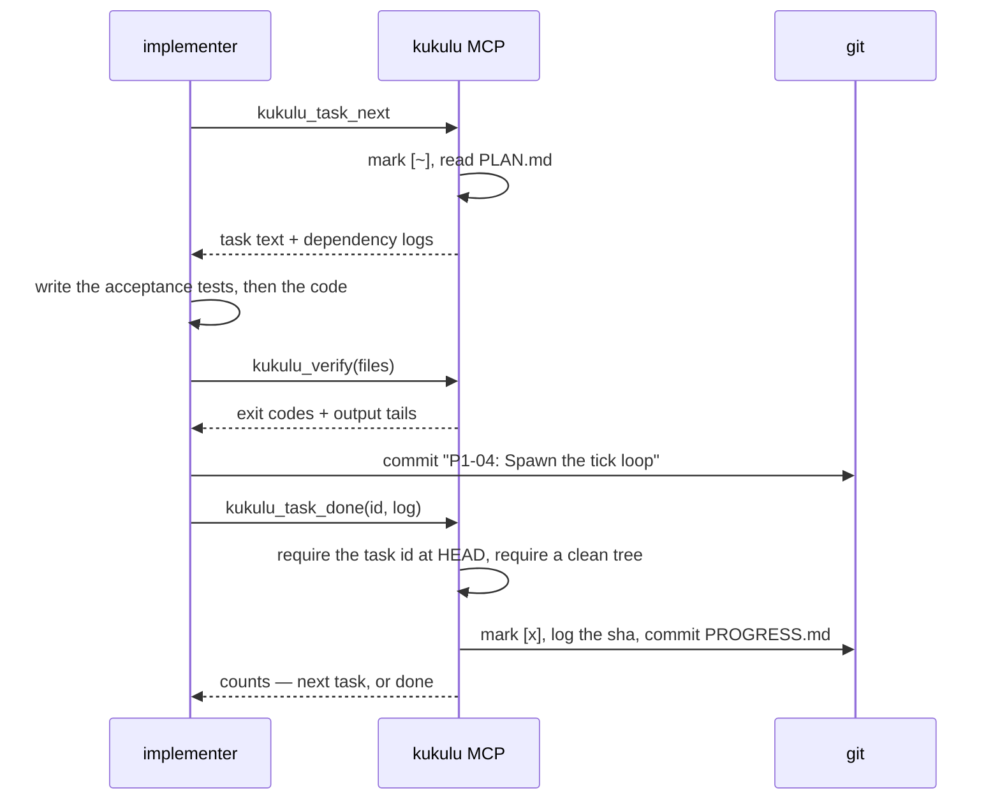
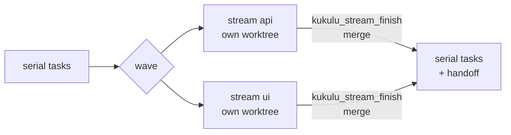

<h1 align="center">Kūkulu</h1>

<p align="center">
  <strong>From specification to merge-ready branch.</strong>
</p>

<p align="center">
  
  
  
  
  
</p>

---

A Claude Code plugin that turns `docs/SPEC.md` into a merge-ready branch without anyone sitting between the stages. It plans, implements, reviews, fixes, reviews again and summarizes. A strong model handles the judgment, a cheaper one handles the mechanical work, and a dependency-free MCP server handles everything that shouldn't be left to a language model. You write the spec and merge the branch; Kūkulu does the part in between.

## The name

*Kūkulu* is a word in ʻōlelo Hawaiʻi, the Hawaiian language. As a verb it means to build, construct or establish; as a noun, a pillar or post, and also a side, border, hedge or horizon (Pukui and Elbert, *Hawaiian Dictionary*, [wehewehe.org entry](https://www.wehewehe.org/gsdl2.85/cgi-bin/hdict?e=q-11000-00---off-0hdict--00-1----0-10-0---0---0direct-10-ED--4--textpukuielbert%2ctextmamaka-----0-1l--11-en-Zz-1---Zz-1-home-k%c5%abkulu--00-4-1-00-0--4----0-0-11-00-2utfZz-8-00&a=d&d=D9586)). The first *u* is long; that is what the kahakō over it marks.

Kūkulu builds from a specification and nothing else: the spec is the only foundation a flight stands on. What a flight leaves behind — the plan, the per-task commits, the review record — is the evidence the build stands on.

> I chose the name because I wanted to honor Hawaiian culture through something I created, and the word felt like the right fit. — Eric Mann

*This project is not affiliated with or endorsed by any Native Hawaiian organization and does not claim to speak for Hawaiian culture. We write the name with its kahakō as a matter of respect for the language, and ask contributors to do the same in prose.*

## Quickstart

You need Node ≥ 22, git, and Claude Code. Nothing to `npm install`.

1. **Install the plugin.** The repo is its own marketplace.

   ```bash
   claude plugin marketplace add DisplaceTech/kukulu
   claude plugin install kukulu@displacetech
   ```

   To install from the website's hosted marketplace instead, run `claude plugin marketplace add https://kukulu.tech/marketplace.json` in place of the first command.

2. **Write a spec** in the project you want built, and commit it.

   ```bash
   cd myproject                      # a git repo on its base branch
   mkdir -p docs
   curl -fsSL https://raw.githubusercontent.com/DisplaceTech/kukulu/main/templates/SPEC.md -o docs/SPEC.md
   $EDITOR docs/SPEC.md              # docs/writing-specs.md says what the planner needs
   git add -A && git commit -m "spec"
   ```

3. **Fly.** The first run in a project sets up the stage agents and, if needed, the MCP allow rule, since an unattended run can't answer a permission prompt (see [Per-project use](#per-project-use)). With the default Anthropic-only routing, the flight goes straight through to a reviewed `build/<date>` branch. Only a role routed off-platform before that first sync stops with `KUKULU: RESTART REQUIRED`; run it again in a new session and it continues.

   ```bash
   claude
   > /kukulu:go-flight
   ```

   `/kukulu:go-flight` is the documented entry point, but Claude can also invoke the controller itself: asking it to "run the kukulu flight" reaches the same instructions. The option you will use most is the review depth, as in `/kukulu:go-flight max review rounds 6`.

4. **Read `docs/SUMMARY.md`, then review the pull request.** With `policies.finalize: "auto"`, a flight whose commits are all signed and that isn't marked breaking gets its pull request marked ready and set to auto-merge once CI is green. A breaking flight, or one with an unsigned commit, is left for you to merge or sign. Kūkulu never merges synchronously; the only merge it asks for is GitHub's own `--auto`.

> **Optional: run a stage on a different model or backend.** By default the planner, reviewer and summarizer use `opus` and the implementer uses `sonnet`, all on your Anthropic account. To point a role somewhere else (`haiku`, a full model id, or a local or hosted model through [claude-code-router](https://github.com/musistudio/claude-code-router)), copy [`templates/kukulu.config.example.json`](./templates/kukulu.config.example.json) to `~/.config/kukulu/config.json`, edit the roles or pick a profile with `"profile": "local"`, and run `/kukulu:go-flight` again. It asks for one more restart only the first time it generates a role that can't be reached by name (a router or local model). [docs/routing.md](./docs/routing.md) has the details, including router setup.

## What's in the box

- **Four stage agents**, each pinned to its own model and effort level by default: `planner` (opus, high), `implementer` (sonnet, medium), `reviewer` (opus, high), `summarizer` (opus, medium). The model changes per stage, not per session, so the expensive one is only used where it matters.
- **Per-role model routing**, from a global config file, optional profiles and a project override, lets you point any role at a cheaper model, local or hosted through a router, without changing how the pipeline runs. See [docs/routing.md](./docs/routing.md).
- **A flight controller**, `/kukulu:go-flight`, that makes no engineering decisions. It asks the MCP what runs next, spawns that agent, and repeats until the pipeline reports `done` or `halt`.
- **A deterministic MCP server** (`mcp/server.mjs`, no dependencies, Node ≥ 22) that owns stage selection, task selection, dependency skipping, checkbox edits, log entries, verification runs and every bookkeeping commit. The skills direct judgment and never describe mechanics.
- **A Stop-hook guard** that refuses to let the implementer stop while tasks are open, and gives up after a configurable cap so a stuck run ends instead of looping.
- **Blocked-task handling** that keeps an unattended run moving: a task that cannot be done is reset, logged and left for the reviewer; its dependents are skipped rather than attempted.
- **Everything on disk.** The plan, progress, handoff, review and summary are all committed, so a flight can be resumed from any point by re-running one command.

## How a flight works


No model decides anything in that loop by reading its own earlier output. At every arrow, `kukulu_next` re-reads the state on disk, so a flight survives compaction, a crashed subagent, or a restart a day later. The models shown are the plugin's defaults; per-machine and per-project routing can point any stage somewhere else (see [docs/routing.md](./docs/routing.md)).

## The task loop

In the implement stage, the MCP handles everything except the code itself:



The implementer never edits `docs/PROGRESS.md`, never chooses its own next task, and cannot mark work done that it did not commit.

## Parallel workstreams

A plan may split independent tasks into **streams**. Tag a task with `**Stream:** <slug>` in `PLAN.md` and `{stream: <slug>}` on its `PROGRESS.md` line; a run of consecutive streamed tasks is a **wave**, and any untagged task is a barrier between waves. The flight controller then runs a wave's streams at the same time, each on its own implementer in its own git worktree (`.kukulu/worktrees/<stream>`, on a branch `<build-branch>--<stream>`), and merges each stream back into the build branch the moment it finishes.



Kūkulu checks a plan's partition rather than trusting it: each streamed task must list concrete backticked `Files touched`, disjoint across a wave's streams, with no dependency between streams of a wave. A wave that fails the check, or whose `parallel.setup` fails, runs serially and logs one feedback entry. A bad partition is a planning defect, not a reason to halt. A command marked `exclusive` (wp-env, anything bound to a port or a directory) only ever runs from the main checkout, and the tasks that trigger it stay out of waves. `docs/kukulu.json`'s `parallel.maxStreams` (default 3; `1` turns it off) and `parallel.setup` (the install a fresh worktree needs) configure it. A plan with no streams behaves as before. See [docs/architecture.md](./docs/architecture.md#parallel-workstreams) for how, and [docs/operations.md](./docs/operations.md#parallel-streams) for what to set and how to recover.

## Install

The [Quickstart](#quickstart) installs from the marketplace. To try a checkout for one session instead:

```bash
claude --plugin-dir /path/to/kukulu
```

Plugin skills are namespaced, so the entry point is `/kukulu:go-flight`; the bare `/go-flight` form does not resolve for plugin skills.

## Per-project use

```bash
mkdir myproject && cd myproject && git init -b main
mkdir docs
cp /path/to/kukulu/templates/SPEC.md docs/SPEC.md   # then write the spec
# drop mockups, fixtures and diagrams next to it in docs/
git add -A && git commit -m "spec"

claude
> /kukulu:go-flight
```

An unattended implementer that hits a permission prompt sits there until the guard's cap trips, so two kinds of prompt have to be dealt with up front, each in its own way:

- **File edits.** The generated `kukulu-<role>` agents carry `permissionMode: acceptEdits`, which plugin-shipped agents cannot. Once they exist, the implementer's edits never prompt and `--permission-mode acceptEdits` on launch is no longer needed.
- **MCP tool calls.** A subagent's permission mode does not cover these: a generated agent's `kukulu_status` call is denied under both `acceptEdits` and `bypassPermissions` unless the session carries an allow rule. `kukulu_agents_sync` writes this rule for you into the project's `.claude/settings.local.json`, unless it is already covered there or in the committed `.claude/settings.json`. See [docs/operations.md](./docs/operations.md#running-a-flight) for the exact rule and what its result field means. Put it in `~/.claude/settings.json` yourself instead if you want it to apply to every project rather than one. The `verify` commands in `docs/kukulu.json` run through the MCP rather than the model's Bash tool, so those never prompt at all.

The first run in a project generates the agents. Claude Code hot-reloads later routing edits to that directory within seconds, so only the first sync, and only when a role is routed to a model the `Agent` tool can't name directly, prints `KUKULU: RESTART REQUIRED` and stops. Run the command again in a new session and it continues. Anthropic-routed roles never need a restart. See [docs/routing.md](./docs/routing.md).

You can also run a stage by hand by delegating to its agent (`kukulu-planner`, `kukulu-implementer`, `kukulu-reviewer` or `kukulu-summarizer` once generated, otherwise `kukulu:planner` and so on), which keeps the same model and effort the flight controller would have used. Invoking `/kukulu:plan-build`, `/kukulu:implement`, `/kukulu:review-build` or `/kukulu:summarize` directly runs the stage on your session's current model instead.

The spec is the input everything else depends on. [docs/writing-specs.md](./docs/writing-specs.md) covers what the planner needs from it and what it does with each section.

## Model routing

Each of the four roles can be pointed at a different model (an Anthropic alias or id, or a model reached through a local router such as claude-code-router) from a global config file, an optional profile inside it, and an optional per-project override. `/kukulu:go-flight` calls `kukulu_agents_sync` before its loop and prints the resolved table; `kukulu_config_show` shows the same table, with the source of every value, at any time. Full precedence, the config file shape, and a claude-code-router walkthrough: [docs/routing.md](./docs/routing.md).

## Files the pipeline owns

| File | Written by | Read by |
|---|---|---|
| `docs/SPEC.md` | you | everyone |
| `docs/PLAN.md` | planner (reviewer appends `## Review fixes (round N)`) | implementer, reviewer |
| `docs/PROGRESS.md` | MCP only | guard hook, everyone |
| `docs/kukulu.json` | planner | MCP (`verify`, `extraVerify`, `maxRounds`, `baseBranch`, `branchPrefix`) |
| `CLAUDE.md` | planner | implementer, reviewer |
| `docs/HANDOFF.md` | implementer | reviewer, summarizer |
| `docs/REVIEW.md` | reviewer | summarizer |
| `docs/SUMMARY.md` | summarizer | you |
| `.kukulu/state.json` | MCP (committed) | `kukulu_next` |
| `.kukulu/implement.lock` | MCP (gitignored) | guard hook |
| `.kukulu/worktrees/<stream>/` | MCP (gitignored) — a parallel stream's worktree, until it is merged back | that stream's implementer |
| `.claude/agents/kukulu-*.md` | MCP (`kukulu_agents_sync`, git-excluded) | Claude Code |
| `~/.config/kukulu/config.json` | you | MCP (`kukulu_agents_sync`, `kukulu_config_show`) |

Checkbox states in `PROGRESS.md`: `[ ]` todo · `[~]` in progress · `[x]` done · `[!]` blocked · `[-]` skipped because a dependency is blocked.

## MCP tools

The server exposes twenty-five tools.

| Tool | Does |
|---|---|
| `kukulu_status` | Everything on disk: docs present, counts, branch/base/head, lock, round, verdict, generated agents, where each flight artifact stands (`artifacts`, `strayArtifacts`) and the last `review:` commit |
| `kukulu_next` | The state machine. Returns `{stage, agent, agentFallback, fallbackAgent, restartRequired, model, agentModel, agentModelExact, round, reason, prompt, streams?}` |
| `kukulu_plan_commit` | Validate PLAN, PROGRESS, `kukulu.json` and `CLAUDE.md` together, list every problem at once, and commit the plan; `renumber: true` rewrites split task ids |
| `kukulu_run_start` | Create or reuse `build/<date>`, record pre-existing untracked files and run policies, probe signing, arm the lock, stamp PROGRESS, commit. Idempotent. With `stream`, also create (or resume) that stream's worktree and run `parallel.setup` in it |
| `kukulu_task_next` | Pick first `[~]` else first `[ ]`, auto-skip dependency-blocked tasks, mark `[~]`, return PLAN text and dependency logs |
| `kukulu_task_done` | Requires `<ID>:` at HEAD and a clean tree; mark `[x]`, log with the sha, commit |
| `kukulu_task_block` | `git reset --hard && git clean -fd`, mark `[!]`, log `BLOCKED:`, commit |
| `kukulu_task_reopen` | Reopen a blocked or skipped task once its blocker is resolved, with every task skipped because of it; log `REOPENED:`, commit |
| `kukulu_verify` | Check `constraints`, then run `verify` plus any `extraVerify` commands matching the touched paths; return exit codes and bounded tails. Every command runs in its own process group, killed whole at its timeout or at 64 MiB of output. With `stream`, runs in that stream's worktree |
| `kukulu_stream_finish` | Finish one stream of a parallel wave: require no open tasks and a clean worktree, merge its branch into the build branch, remove the worktree and branch. A merge conflict aborts, keeps the stream, and halts |
| `kukulu_run_finish` | Requires zero open tasks and `HANDOFF.md`; commit, push, draft a PR against `baseBranch` (unless policies say otherwise), disarm the lock, report a whole-tree constraint scan |
| `kukulu_run_halt` | Record an operator-level reason the run cannot continue; disarm the lock; commit state; never resets or cleans the tree |
| `kukulu_run_resume` | Clear a halt other than a round-cap halt once its cause is fixed, and commit `chore: run resumed` |
| `kukulu_flight_options` | Apply go-flight's options (`maxRounds`, `maxRoundsHard`) to `docs/kukulu.json` and commit; with `resume: true`, also lift a round-cap halt |
| `kukulu_cleanroom_record` | Clean-room mode: record an instruction, an intervention or a verdict on a denial in the hash chain and commit it |
| `kukulu_feedback_log` | Append one pipeline-friction entry to `.kukulu/feedback.jsonl` and commit it immediately, so it survives a flight that never reaches summarize |
| `kukulu_mutate` | Mutation-test one file for the reviewer: apply one exact find/replace, run the verify commands that file triggers (or a `targeted` command with a `filter`; optionally with a shorter `timeoutMs`), always restore it and undo any residue the commands left, commit nothing; reports whether the tests noticed and lists `failedCommands`, and with `confirmKill` re-runs a kill on the unmutated tree |
| `kukulu_review_submit` | `APPROVED` → commit. `CHANGES REQUESTED` → assign `R<N>-<nn>`, append to PLAN and PROGRESS, unblock (with skipped dependents), commit `review: round N` |
| `kukulu_summary_commit` | Write `SUMMARY.md` from `content`, commit it, mark the flight complete, report reviews, fix rounds, the branch's PR and whether to archive |
| `kukulu_similarity` | Score contamination against the configured control pairs inside the server and write `docs/SIMILARITY.md`; the summarizer calls it after the summary |
| `kukulu_attest` | Write the signed attestation bundle for a clean-room flight into `docs/attestation/`, run the bundle's own verifier on it, and commit it only when it passes; the summarizer calls it after the summary |
| `kukulu_flight_archive` | Move a summarized flight's artifacts into `docs/flights/<slug>/` (the spec stays), write a fresh state, commit and push |
| `kukulu_pr_finalize` | End a flight: if every commit is signed, mark the draft PR ready and, unless `breaking`, enable auto-merge; otherwise keep it a draft and record `awaitingSigning`. `resign: true` is for a human |
| `kukulu_agents_sync` | Write `.claude/agents/kukulu-<role>.md` from the merged routing config; only changed files are written |
| `kukulu_config_show` | The merged routing config with the source of every value. Read-only |

Full arguments, return shapes and failure modes: [docs/mcp-tools.md](./docs/mcp-tools.md).

## Clean-room mode

A project with a `docs/cleanroom.json` policy runs in clean-room mode: a guard checks every tool call against the policy before it runs, a logger writes every allowed call and every prompt to a hash-chained log with signed checkpoints, and a gate refuses to start a stage if any of that machinery has changed since the flight began. Without the policy file nothing changes and nothing is paid for. The method is patent pending (U.S. Provisional Application No. 64/178,095, Displace Technologies LLC). [docs/cleanroom.md](./docs/cleanroom.md) has the policy reference, the log format, the gate and the known gaps.

## The guard hook

`scripts/implement-guard.mjs` runs on `Stop` and `SubagentStop`, but only considers a stop that belongs to the implementer: a `SubagentStop` naming it (the matcher in `hooks/hooks.json` already scopes the hook to it) or a `Stop` whose own transcript called `kukulu_run_start`. A controller session merely waiting on a background implementer is never blocked. For a stop it does consider: while `.kukulu/implement.lock` exists and `## Tasks` still has `[ ]` or `[~]` lines, it returns `{"decision":"block"}` naming the next task. `kukulu_task_done`, `kukulu_task_block` and `kukulu_run_start` all reset the lock's counter to zero, so the cap bounds re-blocks since the last time work actually moved, not the whole run. It gives up at the effective cap (`docs/kukulu.json`'s `guardCap`, else `KUKULU_GUARD_CAP`, else 60), naming the stalled task, so a stuck run ends instead of looping.

## Resuming and halting

Everything is on disk and committed, so `/kukulu:go-flight` can be re-run from any point: `kukulu_next` reads the state and continues. Four things stop a flight on purpose, and each writes an explicit `halted` value to `.kukulu/state.json`: a review round reaching `maxRoundsHard`, however well it's going; review findings that stop shrinking for `maxRounds` rounds running (a flight whose findings go 15 → 3 → 2 → 1 is never penalized for taking rounds, only one that stops improving); `kukulu_run_halt`, which an implementer calls for an operator-level problem it can't resolve itself; and a parallel stream whose merge conflicts (`kukulu_stream_finish` aborts the merge and keeps the stream). All four need a human. For a round-cap halt, call `kukulu_flight_options` with `resume: true` (or raise `maxRounds` or `maxRoundsHard`); for the other three, fix the cause and call `kukulu_run_resume`. Then run `/kukulu:go-flight` again. [docs/operations.md](./docs/operations.md) has the rest of the runbook: how each failure looks, how to unstick it, and how to reopen a task once its blocker is fixed (`kukulu_task_reopen`).

## Repo layout

```text
.
├── README.md                    this file
├── .claude-plugin/              plugin.json + marketplace.json
├── .mcp.json                    how Claude Code launches the MCP server
├── mcp/server.mjs               the deterministic half of the pipeline
├── mcp/run-command.mjs          runs one command bounded in time and output
├── hooks/hooks.json             Stop / SubagentStop wiring
├── scripts/
│   ├── implement-guard.mjs      the guard hook
│   ├── lint.sh                  dependency-free syntax + manifest lint
│   └── check-diagrams.mjs       parses every Mermaid block (CI only)
├── site/                        the kukulu.tech landing page, deployed to Cloudflare Pages
├── agents/                      planner · implementer · reviewer · summarizer
├── skills/                      go-flight · plan-build · implement · review-build · summarize
├── templates/
│   ├── SPEC.md                  the spec skeleton the planner reads
│   ├── kukulu.config.example.json   the global routing config, explained in docs/routing.md
│   └── ccr/                     claude-code-router provider manifests
├── docs/                        architecture · MCP reference · routing · spec guide · runbook
└── test/                        harness + thirteen suites, run by test/run.mjs
```

## Documentation map

- [**docs/architecture.md**](./docs/architecture.md): why the pipeline is split this way, what each stage may and may not do, and where state lives
- [**docs/mcp-tools.md**](./docs/mcp-tools.md): every tool, argument, return field and refusal
- [**docs/routing.md**](./docs/routing.md): per-role model routing, covering the global config file, profiles, and running stages through a router like claude-code-router
- [**docs/writing-specs.md**](./docs/writing-specs.md): how to write a `SPEC.md` the planner can turn into a usable plan
- [**docs/cleanroom.md**](./docs/cleanroom.md): clean-room mode, covering the policy, the guard, the log and checkpoints, the gate, and recording what you did
- [**docs/operations.md**](./docs/operations.md): running, resuming, halting, and what to do when a stage misbehaves
- [**docs/plans/**](./docs/plans/): the task-by-task plan behind each release
- [**Website**](docs/site/DEPLOY.md): deploying kukulu.tech to Cloudflare Pages, and the launch checklist
- [**CONTRIBUTING.md**](./CONTRIBUTING.md): layout, tests, and the rules about where behavior is allowed to live
- [**CHANGELOG.md**](./CHANGELOG.md): what shipped, and when

## Adapting it

- The plugin's own model and effort defaults live in `agents/*.md`. Per-machine and per-project overrides live in the routing config instead (see [docs/routing.md](./docs/routing.md)), so you rarely need to edit the plugin to change what runs where.
- Project-specific constraints belong in `SPEC.md` §3. The planner turns them into `## Constraints` in `CLAUDE.md`, which is the first thing the reviewer checks. Nothing project-specific lives in the plugin.
- `templates/SPEC.md` shows the headings the planner looks for by name.

## Testing

```bash
npm run lint    # node --check, bash -n, JSON parse, executable bits
npm test        # every suite
npm test -- guard protocol     # one or more suites by name
KEEP_REPO=1 npm test -- drive  # keep the temp repos to poke at afterwards
```

Thirteen suites, about 3,000 assertions. They cover the plugin manifests and documentation links, the JSON-RPC transport, the `kukulu_next` decision table, the implement-stage tools, the review and summary tools, per-role routing (config merge, `kukulu_agents_sync`, `kukulu_config_show`), `docs/kukulu.json` constraints and their fixture self-tests, `kukulu_feedback_log` and the feedback policy, parallel streams (waves, partition validation, worktrees, merge-back), the guard hook, and serial and parallel end-to-end flights driven over real stdio against a real git repo. CI runs all of it on Node 22, 24 and 26, again on macOS, and again on a machine with no GitHub CLI installed.

## Contributing

The rules are written down: CI must pass on every PR, and `pre-commit install` runs the same checks locally that CI runs remotely. See [CONTRIBUTING.md](./CONTRIBUTING.md).

**Feeding back.** Every stage calls `kukulu_feedback_log` the moment Kūkulu itself costs it time (a refused tool, an ambiguous prompt, a stall), and the MCP logs its own halts and fallbacks the same way. Each entry lands in `.kukulu/feedback.jsonl` and is committed immediately, so it survives even a flight that never reaches summarize. Run `/kukulu:pull-feedback` against a project's checkout to turn its log into a new, numbered file under `docs/feedback/`, and a later release plan works through it item by item. Pulled feedback names the projects it came from, so `docs/feedback/` is gitignored and stays on the maintainer's machine.

## License

[Apache License 2.0](./LICENSE), from 0.4.0 on; see also [NOTICE](./NOTICE).
