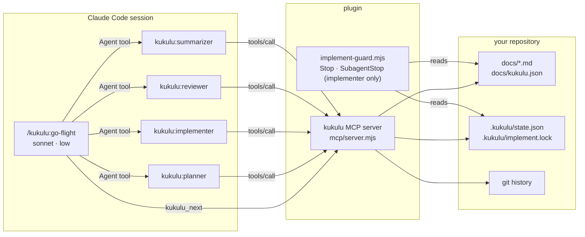
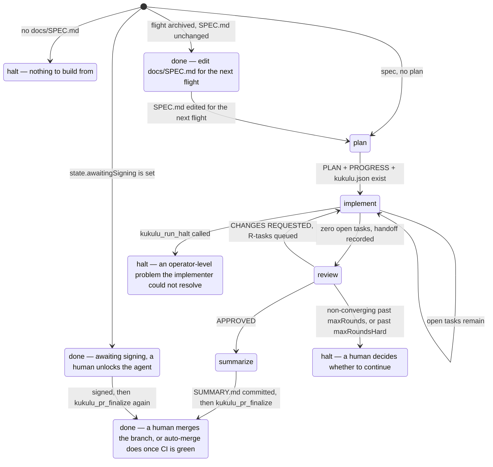
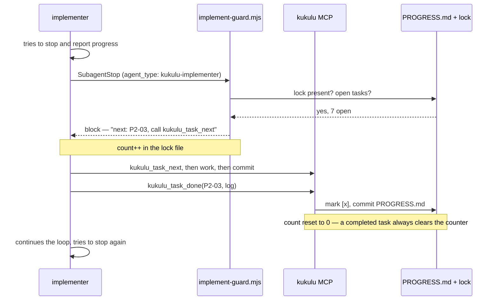

# Architecture

Kūkulu is four subagents, one flight controller, one MCP server and one Stop
hook. The design rule behind all of it: **a language model decides what the
code should be; nothing else.** Stage selection, task selection, checkbox
edits, log entries, verification and commits are code, not prose, because
those are exactly the things a model gets subtly wrong when its context is
compacted for the fortieth time.

## The pieces

The flight controller is deliberately the weakest model in the system. Besides
`Agent`, it may call `kukulu_status`, `kukulu_next`, `kukulu_agents_sync`,
`kukulu_feedback_log`, `kukulu_run_halt` and `kukulu_flight_options`, and
none of them start a run, mark a task, or record a verdict.
`kukulu_agents_sync` writes only the generated agent files under
`.claude/agents/`, the MCP allow rule and a `.git/info/exclude` line (see
[routing.md](./routing.md)). `kukulu_flight_options` writes only the two
review-loop bounds the operator passed to `/kukulu:go-flight`.

## The stage machine

`kukulu_next` is a pure function of what is on disk. It never reads a
subagent's report, and the flight controller is told not to interpret one.

The decision order, exactly as the server evaluates it:

1. No `docs/SPEC.md` → **halt**.
2. `state.halted` is set → **halt** with that reason.
3. `state.awaitingSigning` is set (`kukulu_pr_finalize` found an unsigned
   commit) → **done**, "awaiting signing", with the steps to take.
4. `state.archived` is set, `PLAN.md` is absent and `docs/SPEC.md` is
   byte-identical to the archived copy → **done**, "flight archived". Once
   the spec differs, decision 5 applies and the answer is **plan**, except
   on the pre-0.6.0 layout (decision 4a).
4a. The project is still on the pre-0.6.0 layout (`.foundry/`) and any of
   `PLAN.md`, `PROGRESS.md`, `foundry.json` is missing → **halt**, "run
   `/kukulu:go-flight migrate` first". Planning would write
   `docs/kukulu.json` beside `.foundry/`, and every tool refuses a project
   holding both layouts. Removed in 0.7.0 with the layout fallback.
5. Any of `PLAN.md`, `PROGRESS.md`, `kukulu.json` missing → **plan**.
6. Open tasks → **implement**.
7. Lock present (a run died before its handoff) → **implement**.
8. Nothing recorded as implemented → **implement**.
9. Not yet reviewed → **review**.
10. Verdict `CHANGES REQUESTED` but nothing open → **halt** (an impossible
    state; the tool that queues fix tasks failed).
11. `APPROVED` and not summarized → **summarize**.
12. Summarized → **done**.

The round-cap decision belongs solely to `kukulu_review_submit`: it is the
one place that decides a round is non-converging past `maxRounds` or has
reached `maxRoundsHard`, and records that as decision 2's `state.halted`.
`next()` never re-derives it from `round` and `maxRounds` — open tasks past
a round that was *not* itself halted are just the next implement stage,
exactly like any other round (V3-10). `state.halted` is also set directly
by `kukulu_run_halt` — the tool an implementer calls for an operator-level
problem it cannot resolve itself (F-05): a dead signing agent, a full disk,
a vanished base branch.

Each stage comes back with a `prompt` the flight controller passes to the
subagent verbatim; the implement, review and summarize prompts each end with
one sentence stating this run's policies (`signing`, `push`, `pr`), so every
stage knows them without re-deriving them. The prompt is generated by the
server, not written by the
controller, so the instruction a stage receives does not drift with the
controller's context.

## Who may write what

```mermaid
flowchart TD
    YOU["you"] -->|writes| SPEC["docs/SPEC.md"]
    PLANNER["planner"] -->|writes| PLAN["docs/PLAN.md"]
    PLANNER -->|writes| CFG["docs/kukulu.json"]
    PLANNER -->|writes| CLAUDE["CLAUDE.md"]
    PLANNER -->|"creates, then never touches again"| PROG["docs/PROGRESS.md"]
    IMPL["implementer"] -->|"writes"| HAND["docs/HANDOFF.md"]
    IMPL -->|"source commits only"| CODE["your source tree"]
    REVIEWER["reviewer"] -->|writes| REVIEW["docs/REVIEW.md"]
    REVIEWER -->|"appends via kukulu_review_submit"| PLAN
    SUMMARIZER["summarizer"] -->|writes| SUMMARY["docs/SUMMARY.md"]
    MCP["kukulu MCP"] -->|"sole writer"| PROG
    MCP -->|"sole writer"| ST[".kukulu/state.json"]
    MCP -->|"kukulu_plan_commit validates, then commits"| PLAN
    MCP -->|"kukulu_flight_archive moves the flight into"| FLIGHTS["docs/flights/slug/"]
    MCP -->|"kukulu_pr_finalize readies the PR, notes awaiting signing in"| SUMMARY
```

Three tools make the MCP the committer of a stage's own output.
`kukulu_plan_commit` validates the planner's four files together and commits
them, so the planner never runs `git commit`. `kukulu_flight_archive` moves a
summarized flight's artifacts into `docs/flights/<slug>/` and writes a fresh
state. `kukulu_pr_finalize` is the last call of a flight: it checks the
commits' signatures, marks the draft PR ready, and enables GitHub auto-merge
(never a synchronous merge); when a commit is unsigned it leaves the PR a
draft and appends an `## Awaiting signing` section to `docs/SUMMARY.md`.

`docs/PROGRESS.md` has exactly one writer: the MCP. That is what makes the
guard hook trustworthy — the file it counts open tasks in cannot be edited by
the thing it is guarding.

`.kukulu/feedback.jsonl` does not fit this diagram's one-row-one-writer
shape and is left out of it on purpose: every stage — planner, implementer,
reviewer, summarizer — may append to it through `kukulu_feedback_log`, and
the MCP itself appends to it directly (never through the tool, so no extra
commit appears) at its own halt and fallback points. It is still
append-only and still MCP-owned in the sense that matters: nothing but
`appendFeedback` ever writes a line, and every write is followed by a
commit in the same call, so the file is never left dirty for something
else to notice later.

The reviewer is the one role that may cause a *transient* source edit, and
only through the MCP: `kukulu_mutate` applies one find/replace to one clean
tracked file, runs that file's verify commands, and restores it from `HEAD`
before returning, along with anything else those commands changed that was
clean before (a new untracked file, a rewritten regressions file) — a sentinel in `.kukulu/mutation.json` lets the next
Kūkulu call repair the file if the server dies in between. The reviewer
holds no other way to edit source, and never commits one; a surviving
mutation is a finding, and the fix still goes through the fix-task loop.

## Why the models are split this way

| Stage | Model | Effort | Why |
|---|---|---|---|
| go-flight | sonnet | low | Reads a JSON field, calls one tool. Any judgment here is a bug. |
| planner | opus | high | The plan is the whole product. Everything downstream inherits its mistakes, and nothing downstream is empowered to fix a bad decomposition. |
| implementer | sonnet | medium | Bounded, well-specified tasks with acceptance tests named up front. This is the stage that runs for hours, so it is the one worth making cheap. |
| reviewer | opus | high | Reviews work it did not do, against a spec it must read in full, with the authority to reject. Weak review is worse than none. |
| summarizer | opus | medium | Synthesis across plan, handoff and every review round, for a human who was not there. |

Opus is the default for the planner, reviewer and summarizer because it has
outperformed Fable on the plan, review and summary roles in the operator's own
flights. The "why" column still holds: it describes what each role needs, not
which model supplies it. `fable` remains a legal alias for anyone who prefers it.

These are the plugin defaults, in `agents/*.md`; per-machine and per-project
routing overrides them — see [routing.md](./routing.md). The stage skills
themselves carry no model of their own (`model: inherit`), so invoking one
directly instead of through its agent runs it on your session's current
model.

## The unattended contract

An implement run can last hours and will be compacted repeatedly. Three
mechanisms keep it honest:

- **The lock.** `kukulu_run_start` writes `.kukulu/implement.lock` as JSON
  (`{ count, armedAt, round }`; a bare-number lock left by a 0.2.x run is
  still read correctly). It is gitignored, so `git clean -fd` during a
  blocked task leaves it alone, and `count` is the re-block counter.
- **The guard.** `implement-guard.mjs` runs on `Stop` and `SubagentStop`,
  but only *considers* a stop that belongs to the implementer: a
  `SubagentStop` whose `agent_type` names it (scoped further at the
  hook-registration level by `hooks/hooks.json`'s matcher, so the harness
  never even runs the guard for another subagent), or a `Stop` whose own
  transcript holds a `tool_use` of `kukulu_run_start` (the implement stage
  run directly in a session, not a background flight another session is
  merely waiting on — see [operations.md](./operations.md) and F-07 in the
  project's feedback history). The guard parses the transcript for the
  call itself, not for the text: a controller's transcript always
  *mentions* `kukulu_run_start`, because the implement prompt it relays
  says "Call kukulu_run_start", and matching on the text blocked every one
  of its turn ends (F-01 of the 0.3.1 flight feedback). Three refinements
  serve parallel streams (0.4.0): a lock flagged `paused` — set by
  `kukulu_task_next` when a serial implementer reaches a parallel wave —
  allows the stop; a `SubagentStop` whose transcript's *last*
  `kukulu_run_start` call passed a `stream` is blocked only while *that
  stream* still has open tasks (`{stream: <s>}` tags on the `PROGRESS.md`
  lines), never for a sibling's; and if the stream cannot be determined while
  stream worktrees exist, a wave is in flight and the stop is allowed — the
  controller re-hands out anything left unfinished, so the guard is an
  optimisation there, not the only safety net. For a stop it does consider, it counts `[ ]` and `[~]` lines
  under `## Tasks`; if the lock exists and the count is non-zero it returns
  `{"decision":"block"}` with the next task's id and instructions to call
  `kukulu_task_next`. `kukulu_task_done`, `kukulu_task_block` and
  `kukulu_run_start` all reset the counter to zero, so the cap bounds
  re-blocks since the last time work actually moved, not over the whole
  run — a large plan making normal progress cannot exhaust it. At the
  effective cap (`docs/kukulu.json`'s `guardCap`, carried in the lock;
  else `KUKULU_GUARD_CAP`; else 60) it stops blocking and emits a
  `systemMessage` naming the stalled task instead, leaving the lock in
  place so the next `kukulu_next` sees the unfinished run.
- **The refusals.** `kukulu_task_done` requires HEAD's subject to start with
  the task id and the tree to be clean apart from `PROGRESS.md`.
  `kukulu_run_finish` requires zero open tasks, a `HANDOFF.md`, and a clean
  tree. Neither can be talked into accepting a claim.

A controller session that merely spawned the implementer and is waiting on
it receives its own, unrelated `Stop` events; since that session's own
transcript never *called* `kukulu_run_start` (a `tool_use`, not a mention in
a relayed prompt), the guard allows those without touching the counter (F-07,
and F-01 of the 0.3.1 flight feedback).

## Parallel workstreams

Added in 0.4.0. A plan may split independent tasks into **streams**; a
flight then runs each stream on its own implementer, concurrently, instead
of serializing the whole plan. A plan with no streams behaves exactly as it
did before.

- **Declaring streams.** A task carries `**Stream:** <slug>` in `PLAN.md`
  and a matching `{stream: <slug>}` suffix on its `PROGRESS.md` line
  (`- [ ] P2-03 Title {stream: api}`). The tag is parsed off the title and
  written back verbatim whenever the line is rewritten.
- **Waves are derived, not declared.** A wave is a maximal run of
  consecutive tasks, in `PROGRESS.md` order, that all carry a stream tag. A
  task without one is serial and acts as a barrier, so "scaffold → parallel
  pieces → integration" needs no syntax beyond the one field. Waves are
  recomputed from `PROGRESS.md` on every call and never stored;
  `kukulu_status` reports them as `waves`.
- **The partition is validated, and an invalid one is never fatal.** A wave
  is valid only when every one of these holds:
  - `PLAN.md`'s `Stream:` and `PROGRESS.md`'s tag agree for every task;
  - every task lists concrete backticked paths under `Files touched`;
  - no two streams name overlapping paths (a token ending in `/` is a
    directory and overlaps anything under it);
  - no task depends on a task of a *different* stream in the same wave
    (a dependency on anything before the wave is fine);
  - no task touches an `extraVerify` prefix that holds an `exclusive`
    command (and no `verify` command is exclusive);
  - it has at least two streams.

  An invalid wave runs serially, as if it had no stream tags, and a bad
  partition is recorded as feedback rather than halting an unattended
  flight.
- **Concurrency at the controller.** For a valid wave, `kukulu_next`
  returns the implement stage with a `streams` list, and `go-flight` spawns
  one implementer per entry in a single message and waits for all of them,
  so "one stage at a time" becomes "one `kukulu_next` result at a time".
  A stream that stops early is simply handed out again on the next
  `kukulu_next`; `kukulu_run_start({ stream })` resumes its worktree, so
  the controller never reasons about it. Streams are capped at
  `parallel.maxStreams` (default 3; `1` turns parallelism off).
- **Review-fix rounds.** The reviewer never assigns streams, so its
  `R<N>-<nn>` fix tasks are serial. A task it *unblocks* keeps its
  `{stream}` tag: the fix round re-opens that wave for just the unblocked
  stream, which runs in a fresh worktree and merges back before the serial
  fix tasks.
- **`exclusive` commands.** A command entry marked `exclusive: true`
  starts something keyed to the directory or a port it runs from — wp-env
  is the motivating case — so two of them collide, and serializing their
  *runs* does not help because the environment outlives the command. Such a
  command only ever runs from the main checkout, and any task that
  triggers one is kept out of waves.
- **Worktrees, and where each file lives.** A stream runs in its own git
  worktree, `.kukulu/worktrees/<stream>`, on a branch
  `<build-branch>--<stream>` cut from the build branch (`kukulu_run_start`
  with `stream`, which also runs `parallel.setup` in the fresh checkout).
  Task *code* commits happen there. `PROGRESS.md`, `PLAN.md` and
  `state.json` live only in the main checkout: every stream-scoped call
  reads and writes them there and commits them on the build branch, and a
  stream never edits them. Because a stream branch never touches those
  files, merging it back cannot conflict on bookkeeping.
- **Merging back.** `kukulu_stream_finish` merges each stream when it
  finishes, not at the end of the wave, and removes its worktree and
  branch. A merge conflict is the one stream failure that halts: Kūkulu
  aborts the merge, keeps the stream, and records why. Serial work is
  refused while any stream worktree still exists, so nothing ever runs on a
  main checkout that lacks a finished stream's code.
- **Why one shared `PROGRESS.md` is safe.** Every tool handler is
  synchronous (`spawnSync`, never `await`), so the server handles one call at
  a time whichever stream sent it. Tool calls therefore never interleave,
  and that is what lets concurrent implementers share a single
  `PROGRESS.md` and `state.json`. Keep it that way: an `await` in a tool
  path would end this guarantee.

## Blocked tasks and skipped dependents

A task the implementer cannot finish is not a stopped run. `kukulu_task_block`
hard-resets the working tree, marks the task `[!]`, logs
`BLOCKED: <what was tried / what fails / what the fix might be>`, and commits.
The next `kukulu_task_next` call walks forward, and any task whose
`**Depends on:**` names a blocked or skipped task is marked `[-]` and logged
with its cause — transitively, in one pass, in one commit.

The reviewer decides what happens next: unblock the task with a reason, queue a
fix task that addresses the blocker, or approve around it. An unblock reopens
every task skipped because of the unblocked one, transitively; outside a
review, an operator does the same with `kukulu_task_reopen` once the
blocker is fixed. A reopened dependent that still has another blocked
dependency is simply skipped again on the next walk, so reopening errs
generous on purpose. One blocked infrastructure task once skipped 17 others
that had no sanctioned way back (cleanflate F-18), which is also why the
planner is told to keep `Depends on` narrow. An `APPROVED`
verdict with blocked tasks outstanding is possible but the review skill tells
the reviewer not to give one.

## Review rounds

Two numbers, easy to conflate, so the server owns the distinction rather
than any model computing it (F-10, F-11):

- **`round`** — `state.round` — the number of review-fix rounds whose tasks
  have already been queued. `0` during the initial build; a `CHANGES
  REQUESTED` verdict is the only thing that increments it.
- **`reviewRound`** — always `round + 1` — the number the *next* review is
  stamped with, and the prefix of the fix tasks it may queue. `kukulu_status`
  and `kukulu_next` both expose it, and the review prompt states it in
  words ("This review is round N"), so a reviewer never has to compute it
  from `round` and risk being off by one.

`kukulu_review_submit` reads `docs/REVIEW.md`'s `Round:` line and refuses,
for either verdict, if it is missing or not equal to `reviewRound` — a wrong
number never reaches a commit.

For `CHANGES REQUESTED`, this is the only way findings become work:

1. Each finding is validated — `title`, `goal`, `files` and `tests` are
   mandatory, so "this looks wrong" cannot become a task.
2. Ids are assigned `R<reviewRound>-<nn>`, zero-padded, in submission order.
   A `dependsOn` must name an existing task or one of this same
   submission's own ids; anything else is refused.
3. A `## Review fixes (round N)` section is appended to `PLAN.md` in the exact
   task format the implementer already reads.
4. Checkbox lines are appended to `PROGRESS.md`, after the last task and before
   `## Log`.
5. Tasks named in `unblock` are reset to `[ ]` with the reviewer's reason in
   the log, along with every task skipped because of them.
6. Round, verdict, a new entry in `state.rounds` and — if a cap is reached —
   the halt reason are written to `.kukulu/state.json`.
7. All of it lands in one commit, `review: round N`, then pushed per
   `policies.push` (F-18).

An `APPROVED` verdict commits `REVIEW.md` as `review: round N approved` and
pushes the same way; `state.round` itself does not change, since nothing new
was queued. It still appends to `state.rounds`, with zero fix tasks, so the
history is complete.

Every tool reports a review by the number it was stamped with, and never as a
fix-round count (cleanflate F-21). `kukulu_review_submit` returns `round: N`
for either verdict, with `fixRounds` for an approval. `kukulu_next`'s
`done` reason and `kukulu_summary_commit` count *reviews* (the length of
`state.rounds`) and *fix rounds* (`state.round`) separately. A flight
approved on its second review took 2 reviews and 1 fix round.

**Convergence, not just a count (F-13, F-15).** `state.rounds` is
`[{ round, fixTasks, unblocked, verdict, nonConverging, at }, …]`, one entry
per submission. A `CHANGES REQUESTED` round is `nonConverging` when its
`fixTasks + unblocked` is at least the previous `CHANGES REQUESTED` round's —
round 1 has nothing to compare against, so it is never non-converging.
`kukulu_review_submit` halts when the round number reaches
`maxRoundsHard` (default 6, an absolute ceiling), or when the count of
non-converging rounds so far reaches `maxRounds` (default 3) — whichever
fires first. A flight whose findings shrink every round, 15 → 3 → 2 → 1,
never trips the soft cap no matter how many rounds that takes; one that
goes 4 → 4 → 4 does, on the third round, because none of those rounds
improved on the one before it. The halt message includes the trail of
counts so a human can see the shape of the problem immediately.

The round-trip matters: what the reviewer submits as structured JSON is
rendered into PLAN.md and parsed straight back out by `kukulu_task_next`. A
fix task is a task, and it goes through the same test-first loop as any other.

## State on disk

| Path | Committed | Contents |
|---|---|---|
| `.kukulu/state.json` | yes | `round`, `implemented`, `reviewed`, `verdict`, `summarized`, `halted`, `preexistingUntracked`, `policies`, `signing`, `rounds`; and, once they apply, `signingOverride` (a commit failed to sign and signing was switched off), `awaitingSigning` (`{ unsigned, first, since }`), `breaking`, `haltCap` (which round cap halted the flight, so `resume` knows what lifts it) and `archived` (`{ slug, dir, at }`) |
| `docs/flights/<slug>/` | yes | an archived flight: its PLAN, PROGRESS, HANDOFF, REVIEW, SUMMARY, `kukulu.json`, `state.json` and `feedback.jsonl`, plus a copy of `SPEC.md`; written by `kukulu_flight_archive` |
| `.kukulu/feedback.jsonl` | yes | one JSON line per pipeline-friction entry — `at`, `stage`, `round`, `category`, `message`, `source`; see [mcp-tools.md](./mcp-tools.md#kukulu_feedback_log) |
| `.kukulu/implement.lock` | no (gitignored) | JSON `{ count, armedAt, round }` — the guard's re-block counter (a legacy bare number still reads back correctly) |
| `.kukulu/worktrees/<stream>/` | no (`.gitignore`) | a parallel stream's git worktree, present from `kukulu_run_start({ stream })` until `kukulu_stream_finish` merges it back; `state.streams[<s>]` records its branch and the untracked paths `parallel.setup` left behind, and `state.serialWaves` the waves degraded to serial |
| `.kukulu/mutation.json` | no (`.git/info/exclude`) | present only while `kukulu_mutate` has a file mutated: `{ file, at, original }`, so a crash can be repaired by the next call |
| `docs/PROGRESS.md` | yes | task checkboxes and the per-task log |
| `docs/kukulu.json` | yes | `verify`, `extraVerify`, `build`, `baseBranch`, `branchPrefix`, `maxRounds`, `commandTimeoutMs`, `roles`, `permissionMode` |
| `.claude/agents/kukulu-*.md` | no (`.git/info/exclude`) | the generated per-role agents; see [routing.md](./routing.md) |
| `~/.config/kukulu/config.json` | n/a (outside the project) | the global routing config, its profiles |

A corrupt `state.json` degrades to defaults rather than failing — the tasks on
disk are the real record. A corrupt `kukulu.json` is a hard error, because
guessing at someone's verify commands is worse than stopping.
